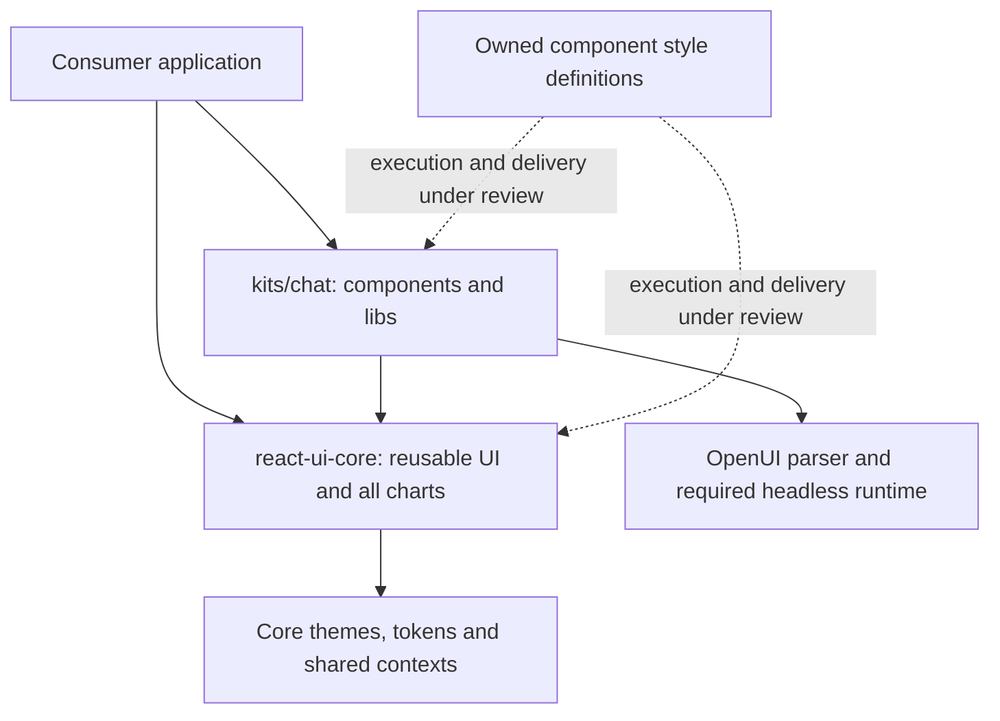

# React UI core and chat kit extraction — draft spec

Status: **draft for review, updated October 24, 2026**. **Styling execution model reopened:** previous acceptance of build-time/static CSS was based on a misunderstanding and has been withdrawn. Package, component and ownership decisions remain in place. Neither runtime nor static delivery is accepted pending joint review of the runtime experiment. Proposed package details are called out below. This document specifies the migration; production migration has not started.

## Current specification work and validation gates

We can continue drafting the specification now. This is authorization to develop a reviewable plan, not a claim that all compatibility/performance requirements have passed or that production migration can start.

The current candidate for review is **unmodified runtime Goober**, with unlayered component styles, existing theme APIs and explicit consumer overrides. Use supported public tooling and ordinary CSS authoring. Do not maintain a parser fork, generated cascade guards, private server targets, automatic host-CSS rewriting or a custom stylesheet-delivery bridge. Preserve historical prototypes as comparison evidence.

- **Demonstrated:** sampled automatic browser styling and actual chat/dashboard streaming. Explicit overrides passed 60 style checks for Button/Input/TextArea across plain CSS and Tailwind v3/v4, including hover, native disabled states and both stylesheet orders. Those overrides were applied through DOM classes; React prop forwarding is not certified by that test.
- **Before styling acceptance:** validate React `className` forwarding and updates, broader components and state selectors (including Radix disabled attributes), relevant portal/theme cases, installed-package/tree-shaking behavior, and stock-candidate browser performance and memory under chat/dashboard streaming. Do not transfer earlier patched/static performance results to stock Goober.
- **SSR:** deferred as a current gate. Optional buffered SSR through documented render/extract/insert APIs is a separate proposal, requiring lifecycle/error cleanup and concurrent HTTP validation. No automatic or streaming SSR promise; no new SSR integration has been approved by this discussion.
- **Before implementation tickets:** review the styling contract and its evidence, core/theme public exports, chat-helper package scope/name, and remaining package details. Core/theme exports, existing customization and new-package-only maintenance are now accepted. Preserve already agreed core/chart/kit ownership and the chat component/library export split.

The execution-model decision remains open until the candidate contract and remaining evidence are reviewed. Standard application integration is distinct from patching a dependency; any consumer setup must be stated explicitly rather than described as automatic.

## Objective and deadline

Submit react-ui-core, containing reusable UI and the full chart set, plus the initial chat kit and its extracted `openuiChatLibrary`, with validation results, by Monday, October 26, 2026. Core must be publish-ready; the chat kit's package/export shape is still to be decided. The submission time of day is not specified. The existing react-ui remains available as the reference baseline. Monday is a submission deadline, not a publication or deprecation date.

## Approved deliverables

1. `react-ui-core`: the complete 65-family reusable UI inventory below, including each family's existing exported subcomponents and types, plus the charts described in point 2.
2. Charts: copy the full existing chart implementation set and supporting chart code into `react-ui-core`. Do not create a separate `react-visualization` package for this scope.
3. `kits/chat`: `openuiChatLibrary` under `libs/`, including its required component definitions and support, plus ModelSwitcher, FollowUpBlock, and FollowUpItem. Do not migrate `openuiLibrary` wholesale into the chat kit. This is an extraction, not a schema redesign.
4. AgentInterface: do not port it for now. Leave its existing implementation in `react-ui`; extraction and destination decisions are outside Monday's scope.
5. Full one-to-one SCSS-to-Goober style conversion for every extracted component and required shared style support, with no dependency on old react-ui SCSS/CSS build inputs. Build and package configuration follow existing react-ui conventions, adapted to each package's surface.
6. Build, type, package, regression, and visual checks with recorded results and explicit remaining gaps, including chat-kit library/component integration.
7. Retain existing react-ui while the replacements are tested and prepared for migration.


Development and all current GitHub writes are restricted to the user's fork. Eventual upstream publication is a future step, not authorization to modify upstream now.

## Approved core inventory

| Group | Count | Component families |
| --- | ---: | --- |
| Inputs and controls | 21 | `Button`, `Buttons`, `Calendar`, `CheckBoxGroup`, `CheckBoxItem`, `Chips`, `DatePicker`, `FormControl`, `IconButton`, `Input`, `Label`, `OptionCards`, `RadioGroup`, `RadioItem`, `Select`, `Slider`, `SwitchGroup`, `SwitchItem`, `TextArea`, `ToggleGroup`, `ToggleItem` |
| Layout and containers | 9 | `Accordion`, `Card`, `CardHeader`, `Carousel`, `Modal`, `SectionBlock`, `Separator`, `Steps`, `Tabs` |
| Text and presentation | 13 | `Callout`, `CodeBlock`, `IconTag`, `IconText`, `InlineHeader`, `InlineMarkdownRenderer`, `MarkDownRenderer`, `Tag`, `TagBlock`, `TextBlock`, `TextCallout`, `TextContent`, `TextContentWrapper` |
| Images | 5 | `Image`, `ImageBlock`, `ImageGallery`, `ImageText`, `ImageTextLarge` |
| Data and lists | 6 | `EditableTable`, `EntityList`, `ListBlock`, `ListItem`, `MetricIndicator`, `Table` |
| Composed cards | 5 | `CompositeCardBlock`, `ContextCardBlock`, `OverviewCardBlock`, `SnippetCardBlock`, `VisualCardBlock` |
| Citations and sources | 3 | `Citation`, `SourceFaviconImage`, `Sources` |
| Loading and help | 3 | `DotMatrixLoader`, `Skeleton`, `TooltipWrapper` |

The table lists 65 reusable UI families; the full Charts subtree is additional core scope. Family counts are not exported React component counts. Include all existing exported parts and types belonging to these families. See [the detailed inventory](../planning/react-ui-core-component-inventory.md) for naming and subpath-export details.

## Component and dependency boundaries

- Core owns reusable UI and the full chart set. There is no separate visualization package in this extraction.
- The chat kit depends on core; core must not depend on kits.
- Preserve support needed by the selected components: ThemeProvider, theme utilities, styles, local helpers, and necessary contexts. Preserve supporting contexts and chart skeletons in core as needed by these components; core is the single owner of these modules for new kits; the proposed public surface is described below.
- Include Modal, ToggleGroup and ToggleItem in the new core root exports even though the old root barrel omits them. Initial component subpaths are deferred by the accepted root-only decision.
- FollowUpBlock, FollowUpItem, and ModelSwitcher belong in `kits/chat` and are part of Monday's submission. They are not core components.
- `openuiChatLibrary` belongs in `kits/chat/libs/` and is part of Monday's submission. Preserve the definitions, including shared definitions, and library support required for equivalent chat-library behavior. This does not authorize carrying over the assembled `openuiLibrary` or its entire public surface. Its future treatment is a pending team decision; leave its existing implementation available in react-ui. Do not automatically carry full react-headless convenience re-exports into core.
- OpenUIChat-related helpers, ToolCall and ToolResult have a separate package boundary for now, with a dependency on core for themes. Audit the exact extracted helper set and public exports before implementation; the package name is pending. AgentInterface is still excluded.
- The chat kit consumes both reusable UI and charts from core. Do not port AgentInterface to satisfy an implicit dependency; surface any such coupling for a separate decision.

## Styling execution model — reopened

### SSR deferred; explicit consumer overrides — October 24

The user deferred SSR support for the current evaluation and authorized testing explicit overrides with stock Goober. The styling decision remains **open**; no custom patches are accepted. This supersedes SSR as a current beta evaluation gate, without claiming SSR works or changing package/component ownership.

The unmodified stock unlayered candidate passed 60/60 sampled normal/hover/disabled style checks across plain CSS, Tailwind v3 and v4, with host CSS before and after Goober. Native disabled Button clicks remained suppressed. The contract uses scoped plain CSS `!important`, v3 `!utility` and v4 `utility!`; no global configuration or custom machinery. Coverage is Button, Input and TextArea; classes were applied through the DOM to isolate cascade behavior. React prop forwarding, other component/state coverage, selector limitations, performance and memory remain unvalidated by this follow-up. This is not full migration approval.

Evidence: [explicit-override report](/Users/ankitdas/thesys/openui-styling-prototype/packages/react-ui/prototypes/styling/runtime-stock-explicit-overrides/REPORT.md).


### Stock Goober only — October 24, decision still open

The user has ruled out maintaining the experimental private parser patch, generated cascade guards, implementation-dependent server target and custom stylesheet-delivery bridge. Preserve those candidates as historical comparison evidence; do not reintroduce that machinery to satisfy the acceptance gates.

The [stock Goober assessment](https://github.com/ankit-thesys/openui-comp/blob/c73310ad10480c2bbcc035cfe18bdeab3681a560/packages/react-ui/prototypes/styling/runtime-stock-goober/REPORT.md) tests the unmodified published Goober 2.1.19 distribution with actual OpenUI components, real chat/dashboard HTTP streaming and parser, React 19.3.1, Chrome and production Next.js 16.4.2. It records 24 catalog runs, four full-chat cases, direct SSR/concurrent-stream/selector controls, bundle/unused-CSS checks and server-first/hydration checks.

Browser automatic styling, sampled unlayered default parity, actual chat/dashboard streaming, buffered SSR with explicit documented extraction, hydration, tested portal theming and direct-import tree shaking pass within the report's scope. Button-only rendering emits 7,415 CSS bytes with no chart/shell CSS; repeated message fixtures reuse the existing stylesheet.

**Blockers remain:** without application integration, SSR and Next streamed markup have no component CSS until client hydration. Overlapping streams share Goober's default stylesheet and extraction drains another request's styles. Unlayered output fails expected consumer overrides; the simple layered policy loses defaults to Tailwind v3 preflight and late-established v4 layer order. These cascade failures are integration constraints, separate from the reproduced complex-selector parser limitations. An ordinary selector rewrite passes the isolated Switch-equivalent control, so a private parser fork is not established as unavoidable.

This is not a stock performance or long-soak approval. Prior static/custom-runtime timings and memory findings do not transfer. Full installed-package, exhaustive selector/state/theme and memory/pressure validation remain unproved. Neither runtime nor static is accepted; migration implementation tickets remain paused. Preserve all package, component, folder and ownership decisions. Review the supported integration contract and remaining blockers together before choosing the execution model.


The user understood the selected experience to be runtime Goober: install the package, import a component, and its styles arrive when it is used. The previous acceptance instead covered build-time Goober and setup-managed static styles. That acceptance is withdrawn. Pause implementation ticket creation until the execution model and consumer contract are reviewed together after the focused prototype.

The required experience is automatic component styling with no manual CSS imports, preferably no separate setup command or consumer build plugin solely for styling, and no unnecessary JavaScript/styles from unused components. Chrome with plain CSS and Tailwind v3/v4 must work. SSR, hydration and streaming require correct initial styles, isolated themes and safe concurrent requests.

Evaluate genuine render-time Goober on actual OpenUI components and the real streaming parser. Distinguish default Goober behavior from any OpenUI-owned SSR/delivery adapter, and disclose all consumer wiring. Runtime generation and JavaScript tree shaking are separate mechanisms. Measure bundle contents and style emission independently.

Preserve the prior static prototype as comparison evidence. Its passing performance results do not establish runtime performance or imply runtime is unsuitable. Component-level static CSS imports are another possible no-setup route; they have not been fully validated and do not inherently require a custom import scanner. See [the focused runtime prototype plan](../planning/goober-runtime-prototype-plan.md).

### Component-owned runtime optimization — October 24, decision still open

The [new frozen prototype report](https://github.com/ankit-thesys/openui-comp/blob/a35351b9f7c3a7253d9aaf1a62907d7b85d3155e/packages/react-ui/prototypes/styling/runtime-component-ownership/REPORT.md) records ordinary component-level style ownership, lazy immutable compilation, native React resource delivery and the existing portal-theme API. It removes eager all-family chat delivery, repeated immutable compilation and the fake browser target. Full-chat inline CSS falls from 1,500,896 to 339,692 UTF-8 bytes (77.4%); a Button-only render emits 13,820 CSS bytes with no chart/shell styles. Correctness passes the twelve-configuration component matrix, actual full-chat integration, production Next SSR/hydration/streaming and concurrent theme checks.

Fresh measurements include 140 Renderer and 120 full-chat samples, 1,680 checked SSR responses including warmups, three fresh-process RSS pairs, and twenty measured minutes of server/browser soak. At concurrency50, median-repetition document p95 is 839 ms runtime versus 743 ms baseline; throughput is 69.7 versus 82.9 responses/s. Paced browser completion is near baseline, but unpaced full-chat dashboard remains 17.2% slower. Baseline linked CSS is not fetched by the SSR pressure client; these are document-delivery observations, not complete-page capacity estimates.

**Memory is not fixed:** matched retained JS heap, DOM/listener/style/rule budgets pass, but the long browser run ends with runtime gross Chrome RSS about 303 MiB above baseline and about 242 MiB above its own warm checkpoint. Short repetitions show the opposite terminal ordering, so attribution remains unresolved; renderer-process totals dominate the long-run growth. Do not infer a CSS leak or dismiss the signal.

The [standard/custom audit](https://github.com/ankit-thesys/openui-comp/blob/a35351b9f7c3a7253d9aaf1a62907d7b85d3155e/packages/react-ui/prototypes/styling/runtime-component-ownership/DESIGN-REVIEW.md) explicitly identifies the inherited private Goober parser patch, generated cascade guards and implementation-dependent server target. Stock Goober still fails the new Switch selector control. These are not accepted production practices. A supported engine/SSR contract, native-memory diagnosis, dashboard cost and remaining coverage require review. Styling remains **reopened**; no migration implementation tickets, production migration or package/component/ownership changes. Historical static and runtime evidence remain preserved.

### Expanded components, full chat and fresh measurements — October 24, decision still open

The [expanded runtime report](https://github.com/ankit-thesys/openui-comp/blob/c2ba24f390d5ebf14ba19178769bfda0a1005d6e/packages/react-ui/prototypes/styling/runtime-expanded/REPORT.md) supersedes the prior bounded Button/cursor findings for this new candidate. All 12 catalog configurations pass (plain CSS/Tailwind v3/v4 × two actual CSS orders × baseline/runtime), including the corrected disabled-cursor contract, sampled controls/portals and Bar/Line/Pie charts. Actual full-chat streaming and production Next checks pass within their documented scope.

This evidence uses **a private experimental Goober 2.1.19 parser patch**, required by actual complex selectors, plus a library-owned cascade guard serializer. It is not stock Goober certification or acceptance of a maintained fork. Full-document SSR/Next preserves styles; fragment SSR loses styles on unmount/remount and remains unsupported. The real SSR chat store is empty; a separately labeled actual Renderer/parser companion supplies SSR content, followed by actual HTTP chat after hydration. AgentInterface is only a test subject, not newly approved for extraction.

Fresh measured runs include 140 Renderer and 120 full-chat samples. Paced completion is close to baseline; saturated paired changes are +11.3%/+8.9% for chat/dashboard Renderer, +15.0% for expanded controls, and +3.1%/+7.0% for full chat. Cold local full-chat readiness adds about 48 ms. At 50 concurrent Next document requests, median repetition p95 rises from 658 ms to 1,406 ms. This test includes runtime inline CSS but does not fetch baseline linked CSS; it measures document delivery, not whole-page capacity. Full chat emits 1,500,896 CSS bytes and still aggregates all 47 selected style families, so minimal unused-style delivery is not established. The dedicated Button entry adds 3,942 gzip JavaScript bytes, excluding baseline CSS.

The fresh twenty measured minutes of server/browser soak (five minutes per arm in each environment) stay within the provisional retained-heap/resource investigation budgets, with no recorded errors or live browser streams after teardown. Runtime still retains about 4.6 MiB more JavaScript heap per browser page; terminal gross Chrome RSS is about 364 MiB above baseline and needs further native/process-memory investigation. RSS can count shared pages more than once and does not isolate CSS allocations. This is bounded evidence, not proof of leak absence or a small total memory impact.

Styling remains **reopened**. Review parser-patch maintenance, style payload/SSR cost, remaining SSR boundaries, package-install/tree-shaking proof, strict CSP and untested variants before accepting an approach or creating migration implementation tickets. Package/component/ownership decisions and historical static evidence are preserved. Read the linked report for exact coverage, raw results, failed attempts, limitations and reproduction.

### Inline theme and automatic CSS follow-up — October 24, decision still open

The [new runtime follow-up](https://github.com/ankit-thesys/openui-comp/blob/d301886813dfe345cd24a9405fdbf18da7650699/packages/react-ui/prototypes/styling/runtime-inline-followup/REPORT.md) supersedes the previous inline-theme browser gap and demonstrates a bounded Button compatibility solution. Inline variables alone preserved SSR/hydration tokens but the original ThemeProvider still wrote to body. A library-owned stable theme scope removes that leak: 29 focused checks pass, including complete tokens, nested/dark/sibling themes, unchanged outside content, client navigation and concurrent documents.

The combined production Next prototype passes 85 recorded checks. Button defaults use a named CSS layer plus an internal, property-specific rollback guard; consumers supply no CSS import, framework flag, styling setup command or build plugin. Initial-shell SSR, hydration, default states, plain CSS/Tailwind v3/v4 normal and hover overrides, and delayed first-visible Button/Table styling pass. Twelve simultaneous distinct-hue requests retain their own tokens. CSS arrives after hidden streamed markup but before React reveals it; hidden no-JavaScript delayed content is not claimed as a visible rendering pass.

The separate Button matrix passes 24/24 state/order cases and 24/24 unrelated-sizing checks. A stricter disabled-cursor priority contract passes only 20/24: ordinary cursor utilities behave differently between v3/plain CSS and v4. Compatibility is demonstrated for Button only, with standard layer order; broader component/chart/full-chat coverage, portals, strict CSP and unusual host resets remain unproved. Stable resource counts across 120 theme changes are not a new long memory soak. This changed candidate has not repeated performance/bundle/long-soak measurements.

These are experimental library integration responsibilities, not an accepted Goober architecture. Styling remains **reopened**, migration implementation tickets remain paused, and package/component/ownership decisions and prior static/runtime evidence remain unchanged. Review the customization contract and broader coverage before acceptance.

### Detailed runtime follow-up — still unaccepted

The [deeper runtime investigation](https://github.com/ankit-thesys/openui-comp/blob/51077c9be7c016441e95acd456ff51ab6d95a3ca/packages/react-ui/prototypes/styling/runtime-detailed/results/DETAILED-RUNTIME-REPORT.md) supersedes the first pass's selector/hover findings for its tested slice: nested Goober objects preserve 293 selected selectors, actual Button states match the original, and normal plain CSS/Tailwind v3 overrides pass. Automatic runtime styling, tested Next SSR/hydration/late delivery and concurrent themes pass. Eighty matched browser runs show no material total-time regression in the bounded paced replay; a Button entry adds 2,802 gzip JavaScript bytes, excluding baseline CSS.

Remaining issues are concrete: Tailwind v4 layered overrides and ordinary hover-utility precedence still fail in both original and runtime styles. A separate layer diagnostic fixes v4 with an explicit layer order but breaks v3 preflight, so a universal layering policy is not established. The short server diagnostic completes 8,000 measured renders; 2,000 distinct runtime themes retain about 42.07 MiB without a plateau. A separate SSR-only control keeping theme variables inline reduces this to about 1.35 MiB while retaining component Goober styling; it is not an accepted change and still needs browser/hydration/CSP validation. Portal/nested/dark themes, full runtime chat-shell integration and broader package coverage remain open. These count-based diagnostics do not replace the earlier twenty-minute static soak.

Styling remains reopened; review the evidence and consumer customization contract before implementation tickets. All package/component/ownership decisions and historical prototypes remain preserved.

### First runtime experiment — unresolved, not accepted

The [focused runtime report](https://github.com/ankit-thesys/openui-comp/blob/8ab2681bf8814d4c3eaaa2ff2afd706255583e94/packages/react-ui/prototypes/styling/runtime-investigation/results/RUNTIME-INVESTIGATION.md) records a separate actual-component prototype at `8ab2681b`. The final library-owned React 19/private-target adapter compiles Goober during render and passes standalone import-only base styling, SSR/hydration, tested theme isolation and delayed Table delivery. Twenty measured real parser/SSE chat/dashboard runs pass final-content and sampled resting-style parity; five pairs per workload are too few for a strong latency claim. A Button-only entry adds 2,760 gzip JavaScript bytes versus baseline JavaScript, excluding baseline CSS, and an unused import is removed. These are distinct bundle/emission tests, not full-library tree-shaking certification.

The candidate **fails ordinary host overrides in plain CSS and Tailwind v3/v4, and changes Button hover behavior**. An earlier `:where(&)` adaptation left components unstyled; its failed sources/results are preserved. The current adapter's selector/conversion limitations do not establish that all runtime Goober designs are unsuitable. Portal styles, arbitrary-theme cache bounds, nested/dark theme coverage, a runtime soak and broader package-install/root-export coverage remain open. The static prototype and all prior measurements remain intact.

Neither runtime nor static is accepted. Review these findings together before deciding a targeted runtime repair or component-level static-import comparison. Migration implementation tickets remain paused.

### Full one-to-one SCSS-to-Goober conversion

**Convert all SCSS styles for every extracted component into component-owned Goober-compatible style definitions. This is a required milestone deliverable, not a later cleanup.** It covers all 65 approved reusable UI families and their exported parts, the full chart set, ModelSwitcher, FollowUpBlock, FollowUpItem, and the shared theme/style support required by those components.

“One-to-one” means preserving the existing appearance and behavior: layout, typography, spacing, colors, responsive rules, hover/focus/disabled states, animations, theme tokens, selector behavior, declaration order and importance. Translate SCSS variables, mixins, nesting and shared utilities into equivalent new-package definitions/helpers. The source syntax can change; observable results must remain equivalent. Any intentional appearance or behavior change requires a separate decision.

The finished core and chat packages must build their CSS exclusively from their own converted definitions and explicitly owned shared support. **They must not import, compile, read or copy SCSS/CSS artifacts from the old `react-ui` package as build inputs.** Do not retain SCSS as the source of truth behind a build-time SCSS-to-Goober adapter, or use a copied precompiled legacy stylesheet as the completed conversion. The new packages must not require Sass to generate their component styles.

Migration tooling may read the old SCSS once to help produce the converted definitions. Validation fixtures may compile the old package independently to obtain a reference stylesheet. Neither is a dependency of the extracted packages' build or consumer artifacts. Existing `react-ui` keeps its own SCSS while it remains the baseline.

The one-to-one conversion and independence from old react-ui SCSS remain the intended migration scope. Whether the owned definitions run at build time or render time is reopened. The prior prototype converted compiled SCSS output at build time; that evidence does not certify a runtime implementation or complete the source conversion.

[ADR 0004](../adr/0004-goober-static-css.md) records the rationale, evidence and tradeoffs. [The evaluation history](../planning/goober-evaluation-history.md) preserves earlier experiments and superseded findings.

### Ownership and dependency direction



Arrows from the application and kit indicate consumption. Dashed styling arrows indicate an unresolved execution/delivery design, not an approved runtime dependency. Existing `react-ui` remains a separate baseline.

| Owner | Responsibility |
| --- | --- |
| `react-ui-core` | Approved reusable UI, every existing chart family, shared tokens, ThemeProvider/hooks, required shared contexts, component styles and SSR theme support |
| `kits/chat` | ModelSwitcher, FollowUpBlock, FollowUpItem, `libs/openuiChatLibrary` definitions/schemas/support, and styles for these kit components |
| Shared tooling | Style parity checks, style/dependency manifests and generated documentation; compiler/runtime integration selected after the experiment |
| Styling integration | Library-owned automatic delivery, SSR/theme isolation and host compatibility; whether additional consumer wiring is unavoidable must be tested |

The kit imports core components and theme context. It does not duplicate the core provider or embed core's entire stylesheet into its own output. Core has no dependency on a kit. Audit actual support imports before assigning runtime peers; do not inherit the old package's entire dependency surface by convenience.

### Consumer styling contract under evaluation

The primary runtime candidate must let consumers install the package and import components, without a manual CSS import, setup command, registry placement, import scanner or consumer build plugin. A ThemeProvider for explicit theme customization is distinct from a mandatory styling-only provider. If any integration requires consumer wiring, record the exact requirement and mark the zero-setup gate unmet; do not hide it in the fixture.

Measure both unused-code removal and unused-style emission. A component-only import must not load unrelated chart/kit code or styles; importing a module and rendering a component are separate cases. Preserve host styles, including a separate host Goober instance, and test style-order/override behavior for plain CSS and Tailwind v3/v4.

The previous automatic setup command, early external CSS and framework layer selection describe the **static comparison arm only**. They are not the accepted consumer contract. Component-level static CSS imports remain an unvalidated alternative to test separately if needed. General editable-source registry/update tooling remains deferred.

### SSR, streaming, themes and cleanup

React 19 remains the agreed minimum for this evaluation. The tested prototype used React 19.3.1; a minimum version is not evidence that every minor version has passed.

The library owns SSR theme-token emission from the resolved core theme. Initial HTML, hydration and delayed Suspense content must agree for light, dark and custom themes. Keep tokens scoped and request state isolated; concurrent requests must not share mutable theme state. Portal overlays must preserve the intended theme when they leave the component subtree.

Cancellation must propagate from unmount/navigation to the actual stream and server request. Where a kit or integration owns the stream lifecycle, it owns that cleanup. Testing the existing AgentInterface is evidence only; AgentInterface stays in `react-ui` and is not being ported by this spec.

External CSS supports the tested static `style-src 'self'` path. Dynamic theme styles and Next streaming under strict CSP need a separately validated nonce/hash contract. Do not change an application's security policy automatically. Strict CSP and custom AgentInterface SSR themes are not certified by the prototype.

### Traceability and generated documentation

Generate a machine-readable manifest from component/style metadata. For each public family record its owner, source paths, export paths, style inputs, generated classes/artifacts, CSS dependencies, token usage, and matching test/story references. For each kit library entry record the schema/definition source and the component export it resolves to.

Use these manifests to generate component/export inventories, style ownership tables, dependency diagrams and validation summaries. Documentation in the site consumes those outputs; authors should not maintain a second hand-written component catalog. Human-authored guidance explains behavior and decisions. A check fails for missing exported-family metadata, unresolved mappings or stale generated outputs.

## Compatibility contract

Preserve existing props as much as possible, with no intended appearance or behavior changes. Preserve selectors, declaration order, importance, nested conditions, theme tokens, states and responsive rules where observable behavior depends on them. Any redesign or observable deviation requires a separate decision.

Compare old and new in isolated documents so global selectors and providers cannot hide missing styles. Also test old and new on separate routes in one consumer application. Arbitrary mixing of old/new providers in one tree is not an interoperability promise.

The build must not depend on executing browser globals on the server, bundle another React instance, or conceal client runtime dependencies. Runtime Goober may include its engine and style definitions in the client bundle; record their actual cost. The static comparison arm must continue to report its no-runtime property separately. Preserve an existing runtime peer only where the extracted source actually requires it.

## Package contract — accepted choices and proposed defaults

The chat component/library export split is accepted. The shared kits package is provisional pending TL approval. Other rows remain proposed defaults unless identified as accepted; none authorize publication.

| Detail | Proposed default |
| --- | --- |
| Core workspace/name | `packages/react-ui-core`, `@openuidev/react-ui-core` |
| Chat workspace/name | Working choice: shared `@openuidev/kits` package with export `./react/chat`, imported as `@openuidev/kits/react/chat`. User selected option A provisionally; TL owns final packaging approval |
| Release stage | Core and the shared kits package have their own beta versions, provisionally `0.1.0-beta.0`; kits exported by the shared package share its version. Confirm names and versions before release |
| Module outputs | ESM/CJS and matching declarations, following existing conventions; build/type errors must fail |
| Exports | Accepted: chat components from `@openuidev/kits/react/chat`; `openuiChatLibrary` from `@openuidev/kits/react/chat/libs`. Accepted: core components/types from the root only, with no initial component subpaths. Primary theme APIs and existing public theme helpers accepted below |
| Styling | Execution/delivery reopened. Preserve component ownership and parity; select runtime or static artifacts and integration only after reviewing the experiment |
| Public theme surface | Core ThemeProvider and existing public hooks/types required by the selected components; keep private contexts private unless consumers need them |
| Peers | React/ReactDOM 19; exact tested ranges and OpenUI runtime peers derived from the extraction dependency audit |

### Accepted core component imports — root only initially

The user selected root-only core component imports for the initial release. Export approved components, charts and their public prop types from `@openuidev/react-ui-core`. Do not introduce component subpath exports in this release. This reduces public entry-point configuration and testing; it does not remove the tree-shaking requirement.

```tsx
import { Button, Card, Input, BarChart } from "@openuidev/react-ui-core";
import type { ButtonProps } from "@openuidev/react-ui-core";
```

Validate an installed-package Button-only consumer: unrelated charts, chat libraries and unused component styles must not be included merely because the root entry exports them. Primary theme exports are accepted below; existing public theme helpers are also preserved; provider behavior changes still require separate review. The already accepted chat component/library entry split is unchanged.

### Accepted primary theme exports — preserve existing APIs

The user accepted root exports for `ThemeProvider`, `useTheme`, `createTheme`, and the existing public types `Theme`, `ThemeMode`, `ThemeProps`. Preserve their existing names, props and intended behavior; do not rename or redesign APIs without necessity and a separate reviewed decision. Consumers do not need to import Goober to use these APIs.

```tsx
import { ThemeProvider, useTheme, createTheme } from "@openuidev/react-ui-core";
import type { Theme, ThemeMode, ThemeProps } from "@openuidev/react-ui-core";
```

Keep the underlying theme context internal to the new package unless a concrete consumer requirement is identified. The existing public theme helpers are also accepted for preservation below; audit the baseline export inventory to prevent omissions. Provider scoping, nested/portal theme behavior and default behavior must not be changed implicitly by this export decision; any necessary compatibility change requires explicit review.

### Accepted existing public theme helpers

Preserve the existing public theme helpers as root exports from `@openuidev/react-ui-core`: `defaultLightTheme`, `defaultDarkTheme`, existing exported swatches and theme types, `useSystemThemeMode`, `useThemeModePreference`, `ThemeModePreference`, `THEME_MODE_ATTRIBUTE` and `THEME_MODE_STORAGE_KEY`. Preserve existing names, signatures and behavior, including existing preference-storage and system-theme semantics. Audit the baseline ThemeProvider export inventory during extraction so additional public helper symbols are not silently omitted. This does not expose private contexts or introduce a new theme API.

### Accepted component customization — existing APIs only

Preserve existing component props (for example Button `variant`, `size`, `buttonType`), ThemeProvider token customization, and `className`/`style` where the component already supports them. Do not introduce an `sx` prop, a new styling API, or a requirement for consumers to call Goober. Do not imply that every component already forwards every native DOM prop.

Consumers may explicitly override conflicting component declarations using scoped plain CSS `!important`, Tailwind v3 important modifiers (`!p-8`, `hover:!bg-green-500`) or Tailwind v4 important modifiers (`p-8!`, `hover:bg-green-500!`). Normal utilities are not guaranteed to override component defaults. This accepts the customization contract, not blanket compatibility or styling-engine approval: React prop forwarding/updates, broader component/state coverage, and stock-candidate performance/memory remain validation gates. Preserve disabled semantics and separately test native disabled and attribute-based disabled states.

### Accepted chat imports

```tsx
import { ModelSwitcher, FollowUpBlock, FollowUpItem } from "@openuidev/kits/react/chat";
import { openuiChatLibrary } from "@openuidev/kits/react/chat/libs";
```

Keep the component entry separate from the library entry: it must not re-export the assembled chat library or import its schema assembly as a side effect. The library entry may depend on chat/core components. Validate the component-only consumer bundle independently; separate entries alone do not prove tree shaking or the absence of all runtime dependencies.

### Proposed folder structure

This is the intended layout, not a statement that these directories already exist. Only relevant packages are shown. Internal filenames are illustrative; preserve existing component family names during extraction. The helper package folder is a placeholder until its name and exact contents are reviewed.

```text
packages/
├── react-ui/                         # EXISTING: retained baseline, including its SCSS
│   └── src/                          # AgentInterface and assembled openuiLibrary stay here
│
├── react-ui-core/                    # NEW: @openuidev/react-ui-core (proposed name)
│   ├── package.json
│   ├── src/
│   │   ├── index.ts                  # Core public exports; exact surface under review
│   │   ├── components/
│   │   │   ├── Button/               # Example; all approved UI families follow
│   │   │   │   ├── Button.tsx
│   │   │   │   ├── styles.ts         # Owned Goober-compatible definitions
│   │   │   │   └── index.ts
│   │   │   ├── Charts/               # Full existing chart set and supporting code
│   │   │   └── ThemeProvider/        # Shared provider and required theme support
│   │   └── styles/                   # Shared tokens/helpers; no old-package SCSS inputs
│   └── dist/                         # Generated JS/types; style artifacts depend on reopened decision
│
├── kits/                             # NEW: shared @openuidev/kits (TL approval pending)
│   ├── package.json                  # Exports ./react/chat and ./react/chat/libs
│   ├── chat/                         # Stable implementation folder for this use case
│   │   └── src/
│   │       ├── index.ts              # Chat component entry
│   │       ├── components/
│   │       │   ├── ModelSwitcher/    # Component + owned Goober style definitions
│   │       │   ├── FollowUpBlock/
│   │       │   └── FollowUpItem/
│   │       └── libs/
│   │           ├── index.ts          # Library entry: exports openuiChatLibrary
│   │           └── openuiChatLibrary/ # Definitions, schemas and required support
│   └── dist/                         # Generated outputs; export map chooses public paths
│
├── chat-helpers/                     # NEW SEPARATE PACKAGE: placeholder name only
│   ├── package.json                  # Depends on core for shared themes
│   └── src/                          # Audited OpenUIChat/ToolCall/ToolResult helpers
│                                     # AgentInterface excluded
│
├── react-headless/                   # EXISTING runtime; no relocation implied
└── react-lang/                       # EXISTING parser/renderer; no relocation implied
```

Future kits can occupy sibling folders such as `packages/kits/dashboard/`; they are not created for this milestone. Shared style integration must have one implementation; its execution model and exact location remain under review. The folder diagram does not commit to a static CSS setup tool.

| Public import | Source entry in this proposed layout |
| --- | --- |
| `@openuidev/kits/react/chat` | `packages/kits/chat/src/index.ts` |
| `@openuidev/kits/react/chat/libs` | `packages/kits/chat/src/libs/index.ts` |

Published exports resolve to built outputs, not directly to these source files. There is no requirement for a `packages/kits/react/chat` folder: `/react/chat` is the public export path. If packaging changes, keep `chat/src/` in place and adjust the manifests/build/export wiring.

### Keep packaging easy to change

Option A is the working implementation direction, subject to the TL's final decision. Keep kit implementation folders independent of the published package name. Retain a dedicated chat source folder (proposed `packages/kits/chat/`) containing its components and `libs/`; an umbrella package manifest and explicit export entries expose it as `@openuidev/kits/react/chat`. The import suffix does not require a matching `react/chat` directory hierarchy.

Within a kit, use local source imports. Import shared UI/theme APIs from core. Keep package-name-specific wiring in public entry points, build/package configuration, consumer fixtures and generated documentation. Avoid cross-kit deep imports and imports from a kit back into the umbrella public entry. Record dependencies per kit so splitting the umbrella does not require discovering them from scratch.

If the TL chooses independent kit packages before release, preserve implementation folders and adjust package manifests, exports/build outputs, dependency declarations, release configuration and consuming imports. Rerun package resolution, CSS delivery and consumer integration checks. This should avoid a broad component-source move; it is not a zero-cost packaging switch. After consumers adopt the public path, preserve it with an umbrella re-export or provide a documented import migration.

Produce an npm tarball and install it into consuming fixtures. Publish-ready means working artifacts and verified metadata, not an actual npm release. Existing headless convenience re-exports are not automatically copied into core.

## Acceptance matrix

The following are implementation gates. Prototype results justify the approach; they do not count as tests of packages that have not yet been extracted.

| Area | Required evidence before marking the milestone ready |
| --- | --- |
| Inventory and boundaries | All 65 reusable UI families, exported parts/types and full chart set accounted for; chat components and library mappings resolve; no kit import in core |
| Build and package | Explicit typecheck, build, package-content checks and ESM/CJS/type resolution pass; tarball installs; no second React; runtime/style payload is measured and appropriate to the subsequently selected model; metadata matches selected dependencies |
| Conversion completeness | Every extracted family/chart/kit component and required shared style input maps to converted Goober definitions; no retained SCSS source pipeline or copied legacy stylesheet as a substitute |
| Independent style build | Build core and chat with old react-ui source and generated style artifacts unavailable; both succeed without Sass or old-package style reads. Baseline comparison runs separately |
| Styling parity | Ordered CSS parity plus baseline screenshots/interactions for every selected family and chart; hover/focus/disabled/responsive states; no unapproved visual or behavior difference |
| Themes and portals | Core alone and core+chat; light/dark/custom themes; nested scopes, actual portal overlays and concurrent-request isolation |
| Compatibility | Initial beta gate: Chrome with plain CSS and Tailwind v3/v4; initial no-JS SSR, hydration, consumer overrides, streaming reveal and navigation. Other browsers/frameworks are outside this required beta matrix |
| Automatic styling | Import-only consumer verified; disclose any required setup/plugin/provider. Correct initial/streamed styling, CSS priority, host-style preservation and unused-component payload checks pass |
| Chat/runtime | Actual parser and kit library, partial/final responses, forms, tables/charts, ModelSwitcher and both follow-ups; history/cancellation/resubmission where the integration supplies them |
| SSR integration | Production Next build/start, no hydration errors, correctly styled first visible content, canceled-stream cleanup, no browser-global server failures |
| Performance and memory | Matched chat/dashboard replay, equal workload priority, recorded payload/timing deltas, bounded SSR pressure and soak, no missing output or extra errors; source/build hashes match evidence |
| Baseline and documentation | Existing react-ui regression checks pass; generated inventories/reports are current; every unavailable check and release limitation is explicit |

The user selected Chrome as the initial beta browser, with plain CSS and Tailwind v3/v4. WebKit, Firefox and Bootstrap are not required beta gates; previous prototype results do not expand this support commitment. Strict CSP, slow-network/cold-load behavior, all chart families and portal themes need extraction-specific evidence; prior representative tests do not certify them.

Reuse the [performance plan](../planning/goober-performance-plan.md) and [executed integration protocol](https://github.com/ankit-thesys/openui-comp/blob/faec229073d033817f3963b7e171ecfbe25c00fd/packages/react-ui/prototypes/styling/VALIDATION-FOLLOWUP.md). Report distributions and absolute values rather than a single average. Correctness, unstyled content, hydration errors or persistent active requests block readiness. For the bounded retention diagnostic, investigate growth above the larger of 10% of warmed heap or 5 MiB per workload, any stylesheet/rule growth, and growing retained DOM/listeners. Longer-lived conversations require their own coverage.

If the Monday timebox cannot satisfy a gate, submit the implementation with the specific gap and its impact; do not label it validated or silently reduce the agreed inventory.

## Preserved static prototype evidence — not runtime approval

These results supported the earlier static decision. The user subsequently withdrew acceptance because the intended runtime experience differed. Preserve the measurements as static comparison evidence, not proof that runtime Goober is slower, unsuitable or accepted:

- Real OpenUI replay: 72 measured browser runs; no material regression observed in the bounded comparison. The candidate preserves 7,825 ordered declarations, adds 7 gzip bytes of CSS, and uses the same client JavaScript without a Goober runtime.
- Installed small-fixture compatibility: ten executed Chrome/WebKit framework combinations pass with the corrected stylesheet delivery. This is narrower than full-library certification.
- Full chat: four standalone cases pass. Production Next: 33 SSR/hydration/theme/framework checks plus four combined actual-chat cases pass.
- Twenty-minute soak: 6,940 SSR responses and 1,100 browser streams across both CSS arms, including warmups. Another 120 verified partial-response cancellations pass. Browser retained heap grows about 3.6 MiB in each arm, within the 5 MiB diagnostic budget; structural counters remain unchanged. Server retained heap stays below its warmed level.

Read the [consolidated integration report](https://github.com/ankit-thesys/openui-comp/blob/faec229073d033817f3963b7e171ecfbe25c00fd/packages/react-ui/prototypes/styling/results/INTEGRATION-VALIDATION.md) and [real performance report](https://github.com/ankit-thesys/openui-comp/blob/4092ca6ccab3e25784cf6accd9c6f4ade3a41ec5/packages/react-ui/prototypes/styling/results/REAL-PERFORMANCE.md) for measured scope and limitations. The prototype converts existing compiled styles; it does not prove that a newly authored Goober port is equivalent without repeating parity checks.

## Required correctness and test-driven implementation

Readability and correctness are simultaneous requirements. "Error-free" is an acceptance target: no known unresolved failures in the agreed in-scope behavior, with reproducible evidence from the required checks. It is not a claim that finite testing proves the absence of every defect. Do not suppress failures, weaken assertions or add unapproved workarounds to achieve green results. Report failures and untested scope explicitly.

Use the TDD skill for the batch POC and subsequent agreed implementation slices: confirm public test boundaries first, write and observe one meaningful failing behavior test, make the smallest conventional change in the new package, then repeat. Do not write the entire batch of tests before any implementation. Keep existing react-ui read-only; baseline defects are reported, not repaired there.

Proposed public test boundaries, awaiting user confirmation: (1) a consumer importing the built core/kit packages and rendering them through their public React APIs; (2) an application using the chat kit library and real parser/streaming runtime. Test user-observable results through those boundaries, not private serializers or internal caches.

Cover public imports/types and unused payload, actual React className/style forwarding and updates, theme/provider/helper behavior, component interactions and accessibility states, native and Radix disabled states, hover/focus/keyboard behavior, plain CSS/Tailwind v3/v4 overrides and ordering, charts/tables, portal themes, partial/final/cancelled streams, and repeated mount/unmount. Include relevant type/build/package checks, baseline appearance/behavior comparisons, and repeatable stock-candidate performance/memory runs for chat and dashboard. Define measurable pass criteria before those runs. SSR remains deferred unless separately brought into scope.

Record the tested revision, environment, commands, results and coverage gaps. A failure blocks acceptance of its affected requirement; unrelated validated work can continue. Migration implementation tickets and final styling acceptance remain gated by review.

Final specification workflow: the user explicitly invoked `mattpocock-skills:to-spec` and confirmed proceeding after the proposed public test boundaries. Synthesize and publish the specification with explicit validation gates; publication does not resolve styling acceptance.

## Implementation sequence and beta maintenance

0. Resolve the reopened execution-model decision through the runtime prototype and human review before creating migration implementation tickets.
1. Lock the reviewed package contract and audit component/support dependencies. Produce the complete export and ownership manifest, including any unresolved chat-helper edges.
2. Implement the subsequently approved style execution and automatic delivery using one actual core component, theme context and chart. Pass parity, installed-package SSR and framework checks before expanding.
3. Extract the remaining core inventory/charts, then the chat components and `openuiChatLibrary`. Convert all their SCSS and required shared style support to owned Goober definitions as part of each extraction. Prove the new style builds work without old react-ui source/artifacts. Keep old implementations available for independent comparison and imports acyclic.
4. Run the full acceptance matrix on built artifacts. Generate the report and migration examples from verified exports; record remaining gaps explicitly.
5. Submit the Monday draft artifacts/results for review. Publication, broader beta rollout and eventual deprecation follow their own readiness decision.

### Accepted maintenance boundary and implementation standards

- Treat existing `react-ui` as a read-only reference. Do not fix, refactor, backport or otherwise modify old production code as part of this extraction. Record the baseline revision used for comparison. Fixes belong only in the new packages.
- Report discovered old-package defects to the user; leave the old implementation unchanged. When a straightforward fix in a new package intentionally differs from an existing bug, document the difference and relevant regression checks rather than claiming exact parity.
- Prefer readable, conventional implementations and supported public tooling APIs. Preserve existing APIs where possible. Do not add custom parsers, dependency forks, private-API adapters, generated compatibility patches or elaborate workaround infrastructure to force a test to pass.
- If a requirement appears to need such a workaround, stop that affected implementation, report the failure, evidence, supported alternatives and maintenance tradeoffs, and obtain the user's decision before adding it. Continue independent work that does not depend on the workaround. Do not claim no alternative exists without evidence.
- Keep code and abstractions small and understandable. Use short comments explaining non-obvious intent; avoid long explanatory blocks and unnecessary machinery.
- Keep work isolated to the new packages and necessary scoped documentation/test/build support. Report any required shared-workspace change before broadening the scope. Avoid unrelated environment changes, global dependency installations or modifications to other projects. Do not delete existing user files or historical prototype evidence as cleanup.

This replaces the earlier proposed dual-maintenance policy. No automatic synchronization or fixes to the old package are authorized.


## Remaining review items and deferred decisions

| Item | Treatment |
| --- | --- |
| Styling execution and delivery | Reopened; runtime prototype and joint review required before implementation tickets. Neither runtime nor static approach is accepted |
| Runtime maintenance and remaining performance evidence | Custom patch machinery is ruled out. Validate performance and memory for the stock candidate; prior custom-candidate RSS/dashboard findings remain historical evidence, not a stock verdict |
| Exact package names, beta versions, peer ranges and exports | Chat component/library split accepted; shared kits packaging awaits TL approval. Review core/theme exports and other proposed metadata before finalizing scaffolding/release configuration |
| OpenUIChat, ToolCall, ToolResult and chat-helper ownership | User selected a separate package for now, depending on react-ui-core for its shared theme. Its name, exact helper inventory and relationship to the chat kit need an audit/review; placement may change later. AgentInterface remains excluded |
| Future assembled `openuiLibrary` ownership | Team decision deferred; preserve it in react-ui and verify no regression while extracting the chat library. This is not permission to contact the team |
| AgentInterface | Keep existing implementation; extraction/destination deferred |
| General source distribution | Later: editable core/chart/kit source, individual components and whole kits, explicit diff-based updates, shared-component reuse, kit-targeted registration; standalone installs do not change kit libraries |
| Additional kits | Dashboard and further use cases follow; no new kits required for this milestone |
| Publication and deprecation | No upstream writes or npm publication now. Choose cutoff only after replacement coverage and a consumer migration path are validated |

The chat kit owning its components and libs and consuming core is confirmed. Shared `@openuidev/kits` packaging is the provisional choice, pending TL approval, with stable kit implementation folders to keep a later packaging change contained. The chat component/library entry split is accepted. Core component/theme exports, existing customization APIs and new-package-only beta maintenance are accepted above. Remaining package/helper details and styling acceptance still require review.

These are document reminders, not scheduled notifications. The styling execution model is reopened independently of the preserved package, component and ownership decisions. Runtime and static candidates require joint review before either is accepted.

## Related decisions

- [Parallel development and migration](../adr/0001-develop-alongside-existing-react-ui.md)
- [Future editable-source distribution](../adr/0002-distribute-editable-component-source.md)
- [Charts live in core](../adr/0003-keep-charts-in-react-ui-core.md)
- [Reopened Goober execution-model decision](../adr/0004-goober-static-css.md)
- [Detailed component inventory](../planning/react-ui-core-component-inventory.md)
- [Planning record](../planning/react-ui-extraction.md)
